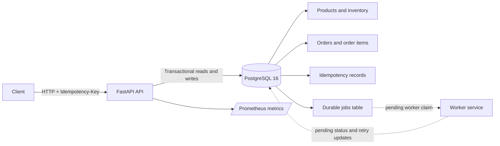

# FulfillOps — Resilient Order-Processing Platform

FulfillOps is a DevOps capstone project for a fictional electronics-fulfilment business. It is designed to accept customer orders through an HTTP API, reserve inventory atomically, persist each accepted order and its background work, and let independent worker processes complete orders asynchronously. The project also targets reproducible container builds, automated quality and security gates, Kubernetes deployment, GitOps reconciliation, observability, and recovery from process and release failures.

> **Project status — 12 November 2026:** The FastAPI/PostgreSQL backend and its database migrations, seed routine, order-acceptance transaction, API tests, and local concurrency tests are implemented. The durable `jobs` table is present and each accepted order is written with a queued job in the same database transaction. The separate worker, full API/worker container stack, CI pipeline/SBOM, Kubernetes/Argo CD deployment, and the required operational fault-injection evidence are still team integration work. This README documents the complete target system while clearly identifying what is implemented and what remains to be demonstrated.

## Contents

- [Project goals](#project-goals)
- [Current implementation status](#current-implementation-status)
- [Architecture](#architecture)
- [Technology stack](#technology-stack)
- [Repository structure](#repository-structure)
- [API contract](#api-contract)
- [Catalog and initial inventory](#catalog-and-initial-inventory)
- [Run the current backend locally](#run-the-current-backend-locally)
- [Run the automated tests](#run-the-automated-tests)
- [Order-processing and worker design](#order-processing-and-worker-design)
- [Target delivery and deployment workflow](#target-delivery-and-deployment-workflow)
- [Reliability and security requirements](#reliability-and-security-requirements)
- [Verification evidence and remaining work](#verification-evidence-and-remaining-work)
- [Team responsibilities](#team-responsibilities)

## Project goals

The system is designed around the following requirements:

1. Accept a valid order and return HTTP `202 Accepted` only after the order, inventory reservation, idempotency record, and durable work item have been committed.
2. Prevent overselling when multiple clients compete for the same limited stock.
3. Make retries safe: the same idempotency key and same semantic request must return the original order without reserving stock again.
4. Process accepted orders asynchronously in a separate worker service.
5. Recover work after a worker process dies, apply bounded retries with backoff, and retain permanently failing work for operator review.
6. Run two API replicas and two independently operating worker instances against shared persistent state.
7. Validate changes through automated tests, CI quality/security gates, an SBOM, container builds, Kubernetes health checks, GitOps reconciliation, and reproducible failure-recovery demonstrations.

The detailed design, data model, request sequence, worker protocol, threat model, and deployment target are in [`docs/architecture.md`](docs/architecture.md). The database decision is recorded in [`docs/ADR-001.md`](docs/ADR-001.md).

## Current implementation status

| Area | Status | Notes |
|---|---|---|
| FastAPI API | Implemented | Catalog, inventory, order creation, order lookup, liveness, readiness, and metrics routes are present. |
| PostgreSQL schema | Implemented | Products, inventory, orders, order items, idempotency records, and durable jobs. |
| Alembic migrations | Implemented | Current migration head: `7a894950e14c`. |
| Atomic inventory reservation | Implemented and locally tested | Conditional database updates execute inside the order transaction; a failed multi-SKU reservation rolls back. |
| Idempotency | Implemented and locally tested | Normalized payload hashing, transaction-scoped PostgreSQL advisory locking, and durable idempotency records. |
| Durable job creation | Implemented | One queued job is inserted in the same transaction as each new order. |
| Separate worker | Pending | Worker claiming, processing, retries, lease recovery, and dead-letter handling still need to be implemented and tested. |
| Docker API/worker images and full Compose stack | Pending | The current Compose configuration is used to run PostgreSQL for local backend development. |
| CI, security scanning, SBOM, immutable image publication | Pending | Must be added and evidenced in GitHub Actions. |
| Kubernetes and Argo CD/GitOps | Pending | Target includes two API replicas and two independently operating worker instances. |
| Fault injection, observed p95, rollout and incident evidence | Pending | Must be demonstrated in an isolated lab environment. |

The implementation status above is deliberately separate from the final target architecture. A design or requirement described below must not be treated as completed evidence until it is implemented and verified in the repository.

## Architecture

The current backend and the complete target system follow this flow:



The API and database portions are implemented. The worker paths in the diagram are the required integration design and are not yet a running service in the current backend snapshot. The complete architecture is documented in [`docs/architecture.md`](docs/architecture.md).

## Technology stack

| Layer | Technology | Responsibility |
|---|---|---|
| Runtime | Python 3.12 | Backend application runtime. |
| HTTP API | FastAPI | Routing, HTTP responses, OpenAPI documentation. |
| Validation/configuration | Pydantic and Pydantic Settings | Request schemas and environment-based configuration. |
| ORM/database access | SQLAlchemy 2 | Models, queries, and transaction management. |
| Database | PostgreSQL 16 | Authoritative order, inventory, idempotency, and durable-job state. |
| Migrations | Alembic | Versioned database schema changes. |
| Tests | pytest and pytest-cov | API, persistence, and concurrency tests. |
| Linting | Ruff | Static style and lint checks. |
| Metrics | `prometheus-client` | Prometheus exposition endpoint and application metrics. |
| Local database runtime | Docker Compose | Starts PostgreSQL for current local development. |
| Target platform | Docker, Kubernetes/kind, Argo CD, GitHub Actions | Container delivery, orchestration, GitOps, and CI/CD; integration pending. |

PostgreSQL is used as both the authoritative business-data store and the durable work table. The current design does not require a separate Redis broker. See [ADR-001](docs/ADR-001.md) for the decision and trade-offs.

## Repository structure

### Implemented backend structure

```text
FULFILLOPS/
├── app/
│   ├── api/
│   │   ├── catalog.py
│   │   ├── inventory.py
│   │   └── orders.py
│   ├── models/
│   │   ├── product.py
│   │   ├── inventory.py
│   │   ├── order.py
│   │   ├── order_item.py
│   │   ├── idempotency.py
│   │   └── job.py
│   ├── schemas/
│   ├── services/
│   │   └── orders.py
│   ├── config.py
│   ├── database.py
│   ├── main.py
│   ├── metrics.py
│   └── seed.py
├── db/
│   └── migrations/
│       ├── env.py
│       └── versions/
├── tests/
│   ├── conftest.py
│   ├── test_api.py
│   └── concurrency/
│       └── test_concurrent_orders.py
├── compose.yaml
├── alembic.ini
├── requirements.txt
├── pyproject.toml
├── .env.example
└── README.md
```

### Additional target directories required for the complete capstone

These components should be added as they are implemented; they are not all present in the current backend snapshot.

```text
FULFILLOPS/
├── worker/                     # Separate worker process and retry/recovery logic
├── infra/
│   ├── k8s/                    # API/worker Deployments, Service, storage and probes
│   └── argocd/                 # Argo CD Application/GitOps configuration
├── .github/
│   └── workflows/              # CI quality, test, scan, SBOM and build gates
├── docs/
│   ├── architecture.md
│   ├── ADR-001.md
│   ├── threat-model.md         # May be maintained as a separate document
│   └── incident-postmortem.md  # Complete after the controlled incident exercise
└── scripts/                    # Safe test reset, fault injection and evidence probes
```

## API contract

The local API base URL is `http://127.0.0.1:8080`. The public API contract is version 1.1 and the required routes and response schemas are unchanged by the advanced reliability requirements.

| Method | Path | Successful behavior |
|---|---|---|
| `GET` | `/health/live` | Returns `200` with `{"status":"ok"}`. Liveness is independent of database availability. |
| `GET` | `/health/ready` | Returns `200` with `{"status":"ready"}` when the database is reachable and required migrations are applied; otherwise `503` with `{"status":"not_ready"}`. |
| `GET` | `/api/v1/catalog` | Returns the three required catalog SKUs and prices. |
| `GET` | `/api/v1/inventory/{sku}` | Returns SKU and nonnegative available quantity; unknown SKU returns `404 SKU_NOT_FOUND`. |
| `POST` | `/api/v1/orders` | Validates the request, reserves stock, persists the order/idempotency/job records, and returns `202`. |
| `GET` | `/api/v1/orders/{order_id}` | Returns the order ID, status, and total; unknown order returns `404 ORDER_NOT_FOUND`. |
| `GET` | `/metrics` | Returns Prometheus text exposition format. |

### Create-order request

A request must include an `Idempotency-Key` header containing 8–128 printable ASCII characters.

```http
POST /api/v1/orders
Content-Type: application/json
Idempotency-Key: demo-order-0001
```

```json
{
  "customer_id": "CUST-042",
  "items": [
    {"sku": "KIT-100", "quantity": 1},
    {"sku": "PART-200", "quantity": 2}
  ]
}
```

A first successful acceptance returns `202`:

```json
{"order_id":"<uuid>","status":"queued"}
```

The acceptance response is sent after the order and stock reservation are committed, but before worker processing. A semantically identical replay with the same key returns the original order ID and does not reserve stock again. Reusing the key with a different payload returns `409 IDEMPOTENCY_CONFLICT`.

### Validation and error codes

All error responses use this shape:

```json
{
  "error": {
    "code": "OUT_OF_STOCK",
    "message": "Not enough items available"
  }
}
```

| HTTP status | Error code | Meaning |
|---:|---|---|
| `400` | `IDEMPOTENCY_REQUIRED` | Idempotency-Key is missing. |
| `400` | `INVALID_JSON` | Request body is not valid JSON. |
| `400` | `INVALID_REQUEST` | General request structure is invalid. |
| `422` | `INVALID_QUANTITY` | Quantity is not a valid positive integer from 1 to 20. Booleans are not accepted as integers. |
| `422` | `INVALID_SKU` | SKU is not part of the catalog. |
| `409` | `OUT_OF_STOCK` | Requested stock is not available. |
| `409` | `IDEMPOTENCY_CONFLICT` | An existing key was reused with a different semantic payload. |
| `404` | `SKU_NOT_FOUND` | Inventory was requested for an unknown SKU. |
| `404` | `ORDER_NOT_FOUND` | Requested order does not exist. |

The request body limit is 16 KiB. `customer_id` must be a nonempty string of at most 64 characters. `items` must contain 1–10 lines. Each quantity must be 1–20. Repeated lines for the same SKU are aggregated before stock checks and total calculation.

## Catalog and initial inventory

The seed routine inserts the following products and inventory when they do not already exist. It does not reset stock on every application restart.

| SKU | Price in cents | Display price | Initial stock |
|---|---:|---:|---:|
| `KIT-100` | 1299 | €12.99 | 7 |
| `PART-200` | 599 | €5.99 | 12 |
| `PACK-300` | 249 | €2.49 | 5 |

A clean isolated test dataset must start with these quantities. The concurrency and stress checkers consume stock, so they must never be run against a shared or production database.

## Run the current backend locally

These instructions describe the implemented local backend workflow on Windows 11 using PowerShell. They do not claim that the complete worker/API Compose stack is available yet.

### 1. Clone the repository and create a virtual environment

```powershell
git clone https://github.com/BenjaminGERARD2006/FULFILLOPS.git
Set-Location FULFILLOPS

py -3.12 -m venv .venv
.\.venv\Scripts\Activate.ps1
python -m pip install --upgrade pip
pip install -r requirements.txt
```

If PowerShell blocks activation, use the permitted execution-policy approach provided by your institution or activate the environment from a terminal configured for Python. Do not commit the `.venv` directory.

### 2. Create the local environment file

```powershell
Copy-Item .env.example .env
notepad .env
```

Set values for the local development database. Use a private password and do not paste it into Git, screenshots, issues, or logs.

```dotenv
POSTGRES_DB=fulfillops
POSTGRES_USER=fulfillops
DB_PASSWORD=replace-with-a-local-private-password
DB_HOST=127.0.0.1
DB_PORT=5433
```

The Compose mapping exposes the PostgreSQL container on host port `5433` to avoid conflict with a local PostgreSQL service already using port `5432`. Keep `.env` private; `.env.example` must contain placeholders only.

### 3. Start PostgreSQL

```powershell
docker compose up -d db
docker compose ps
```

Wait until the database container is healthy before continuing.

### 4. Apply migrations and seed the development database

```powershell
alembic upgrade head
python -m app.seed
```

The seed routine inserts missing records but does not replenish inventory already consumed by orders.

### 5. Start the API

```powershell
python -m uvicorn app.main:app --reload --port 8080
```

Open the interactive API documentation at <http://127.0.0.1:8080/docs>.

In a second PowerShell window, verify the service:

```powershell
Invoke-RestMethod http://127.0.0.1:8080/health/live
Invoke-RestMethod http://127.0.0.1:8080/health/ready
Invoke-RestMethod http://127.0.0.1:8080/api/v1/catalog
```

### 6. Create a test order

Use a unique idempotency key for each new logical request:

```powershell
$headers = @{ "Idempotency-Key" = "demo-order-0001" }
$body = @{
    customer_id = "CUST-042"
    items = @(
        @{ sku = "KIT-100"; quantity = 1 }
        @{ sku = "PART-200"; quantity = 2 }
    )
} | ConvertTo-Json -Depth 5

Invoke-RestMethod -Method Post `
    -Uri http://127.0.0.1:8080/api/v1/orders `
    -Headers $headers `
    -ContentType "application/json" `
    -Body $body
```

The current backend returns an acceptance receipt with `status: "queued"`. Because the separate worker is pending, an order will remain queued until worker integration is completed.

## Run the automated tests

The test suite is destructive to the application tables in the database selected by its environment settings. It has a safety guard and refuses to run unless the selected database name is exactly `fulfillops_test`.

### 1. Create the isolated test database once

With the PostgreSQL Compose service running:

```powershell
docker compose exec db psql -U fulfillops -d postgres -c "CREATE DATABASE fulfillops_test;"
```

If PostgreSQL reports that the database already exists, do not recreate or drop it; continue with the next step.

### 2. Select the test database and apply migrations

```powershell
$env:POSTGRES_DB = "fulfillops_test"
python -c "from app.config import settings; print(settings.POSTGRES_DB)"
alembic upgrade head
```

The printed database name must be `fulfillops_test` before running tests.

### 3. Run tests and lint checks

```powershell
python -m pytest -v
ruff check app tests
python -m pytest --cov=app --cov-report=term-missing
```

PowerShell environment variables are scoped to the current terminal window. Set `$env:POSTGRES_DB = "fulfillops_test"` again in every new window before running tests. The test fixture truncates and reseeds the test tables around tests; it must never be pointed at the development or a production database.

When finished, remove the test database override from that terminal:

```powershell
Remove-Item Env:POSTGRES_DB -ErrorAction SilentlyContinue
```

**Important:** Do not run the public checker's `--concurrency` or `--stress` options against the main development database. Those tests consume inventory. Use a freshly seeded, isolated test environment only.

## Order-processing and worker design

### API transaction boundary

For a new order, the service normalizes and aggregates duplicate SKU lines, hashes the canonical payload, and opens a PostgreSQL transaction. It serializes requests sharing an idempotency key using a transaction-scoped advisory lock. It then checks the durable idempotency record, validates products and prices, and reserves each SKU using a conditional database update. The order, order lines, idempotency record, inventory decrements, and one queued `jobs` row are committed together.

This transaction boundary ensures that an accepted order does not exist without its durable job and that a multi-SKU request cannot partially reserve stock if one line fails. The API reserves stock at acceptance time; the worker must not decrement inventory again.

### Target worker behavior — implementation pending

The worker is a separate process/service. Its required responsibilities are:

- Atomically claim due queued work using database row locking (normally `FOR UPDATE SKIP LOCKED`) so two workers do not claim the same live job.
- Reclaim jobs whose `running` lease has expired after a worker crash.
- Persist the worker identity, attempt count, and lease expiry.
- Transition the order to `processing`, then to `completed` on success.
- On a retryable error, record a safe error, clear/renew lease fields as appropriate, and schedule a bounded retry using exponential backoff.
- After the retry limit, set the job to `dead` and the order to `failed`; retain the records for operator review.
- Make the business effect idempotent under at-least-once delivery. Delivery itself is not exactly once; the worker must ensure that retries or lease recovery do not perform the same business outcome twice.
- Never reserve inventory again. Do not automatically restock a failed/poisoned order unless a separate compensating workflow is designed, reviewed, and tested.

The current `jobs` table exposes `id`, `order_id`, `status`, `attempts`, `max_attempts`, `available_at`, `locked_until`, `locked_by`, `last_error`, `created_at`, and `updated_at`. The model default for `max_attempts` is 5.

See [`docs/architecture.md`](docs/architecture.md) for the full worker state model and integration invariants.

## Target delivery and deployment workflow

The complete capstone target is:

1. **Pull request CI:** formatting/lint, unit and integration tests, isolated public contract checker including concurrency/stress, application and worker image builds, dependency/image vulnerability scanning, and SBOM generation.
2. **Quality gate:** required checks must pass before an artifact can be promoted. Critical findings follow a documented blocking policy; informational findings are recorded.
3. **Immutable build output:** publish images using a commit-SHA tag or digest; do not deploy a mutable `latest` tag as the release identity.
4. **Local Compose:** one reproducible stack for API, worker, and PostgreSQL, with health checks, volumes, environment configuration, and non-root application containers.
5. **Kubernetes:** API Deployment with two replicas, worker Deployment with two independent worker instances, Service, ConfigMap, Secret references, readiness/liveness probes, CPU/memory requests and limits, and persistent database storage/configuration.
6. **Argo CD/GitOps:** reconcile the cluster from the Git repository. Demonstrate drift detection and reconciliation. A broken release must be restored to a known-good Git revision; a manual cluster patch is not the final recovery state.
7. **Operations evidence:** two controlled fault exercises, 30-second continuous readiness probe during a healthy rolling update, at least 200 HTTP samples for an observed p95, metrics/log evidence, and a blameless incident report.

These items are requirements for final team acceptance, not claims that this deployment pipeline has already been created. The exact target components and proof checklist are in [`docs/architecture.md`](docs/architecture.md).

## Reliability and security requirements

The system must preserve these invariants:

- `inventory.available` is never negative.
- A failed multi-item reservation rolls back all stock decrements.
- A client idempotency key maps to at most one accepted order.
- Replaying the same key and semantic payload does not reserve stock twice.
- Reusing a key with a different semantic payload is rejected.
- The order, item rows, inventory changes, idempotency record, and durable work item are committed atomically.
- An accepted order survives API and worker restarts.
- Worker retries and lease recovery do not produce a duplicate business outcome.
- A permanently failing order remains visible as `failed` and its job remains available for operator review.

Security basics:

- Keep `.env`, database passwords, GitHub tokens, private keys, and production credentials out of Git.
- Use environment variables or the deployment platform's Secret mechanism; `.env.example` contains placeholders only.
- Validate inputs and enforce the request body limit.
- Return safe machine-readable errors; do not expose SQL, stack traces, credentials, or personal data.
- Keep tests and stock-consuming checkers on an isolated test database.
- Avoid customer IDs and idempotency keys as Prometheus labels.
- Run fault injection only against infrastructure controlled by the team.

## Verification evidence and remaining work

### Backend evidence recorded on 12 November 2026

The latest reported local backend verification was:

- `python -m pytest -v`: **24 passed**.
- `pytest-cov`: **94% overall line coverage** at the time of the report.
- `ruff check app tests`: all checks passed.
- Python compilation check: passed.
- Concurrency tests: seven distinct-key orders accepted from ten competitors for seven available units; eight concurrent identical-key calls returned one order ID and created one reservation; duplicate SKU lines were aggregated.
- Manual API checks: catalog, inventory, health, order acceptance/retrieval, idempotency replay/conflict, out-of-stock rollback, unknown SKU, and metrics endpoint.

These are local backend results from the current implementation snapshot. They are not a result from the full public checker, cross-replica API test, worker recovery test, CI pipeline, or Kubernetes deployment. Re-run all checks after team integration.

### Remaining final-acceptance evidence

- [ ] Implement and test the separate worker.
- [ ] Demonstrate two workers processing different jobs safely.
- [ ] Kill a worker while a committed order is processing; prove lease recovery and one business outcome.
- [ ] Inject a deterministic poison job; prove bounded retries and persistent `dead`/`failed` state.
- [ ] Run two API replicas against the same database; prove eight same-key requests return one order ID and reserve stock once.
- [ ] Run the public API checker with both `--concurrency` and `--stress` on a fresh isolated test database, with no skipped checks.
- [ ] Build multistage non-root API/worker images and a complete Compose stack.
- [ ] Add CI quality/security gates, a documented vulnerability policy, SBOM artifact, and immutable image tag/digest.
- [ ] Deploy to kind/Kubernetes with two API and two worker instances; configure persistent storage and health probes.
- [ ] Demonstrate Argo CD `Synced`/`Healthy`, drift correction, and recovery from a deliberately broken revision through Git.
- [ ] Record a time-stamped 30-second successful rolling-update probe.
- [ ] Collect at least 200 HTTP samples and report the observed p95 with test conditions and limitations.
- [ ] Perform both controlled fault exercises and complete a blameless incident postmortem.
- [ ] Add the final evidence to the report and demo; document each student's contribution and assistance disclosures.

## Team responsibilities

The agreed initial division of work is:

| Team member | Primary responsibility | Integration points |
|---|---|---|
| Student 1 — Backend/database | FastAPI routes, SQLAlchemy models, PostgreSQL schema/migrations, order transaction, inventory reservation, idempotency, seed logic, backend tests. | Publishes the order and `jobs` database contract for the worker. |
| Student 2 — Worker/reliability | Separate worker, atomic job claim, leases, expired-lease recovery, bounded retry/backoff, dead-letter handling, worker tests and worker incident evidence. | Uses the shared PostgreSQL `jobs` table; must not reserve inventory again. |
| Student 3 — Platform/delivery | API/worker containers, Docker Compose, GitHub Actions, image scanning/SBOM, Kubernetes/kind, Argo CD/GitOps, deployment and rollout evidence. | Packages and deploys the API and worker against the shared database configuration. |

All team members should be able to explain the full request lifecycle, failure boundaries, concurrency controls, and their own implementation/review contributions during the individual oral defense.

---

## Useful commands

```powershell
# Check local changes and recent history
git status
git log --oneline -5

# Check services
docker compose ps

# Check migrations
alembic current
alembic heads

# Run backend quality checks (select fulfillops_test first)
python -m pytest -v
ruff check app tests
```

**Repository:** <https://github.com/BenjaminGERARD2006/FULFILLOPS>
