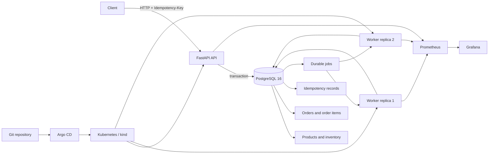

# FulfillOps — Resilient Order-Processing Platform

FulfillOps is a DevOps capstone project for a fictional electronics-fulfilment business. It accepts customer orders through a FastAPI service, reserves inventory transactionally, stores the accepted order and its background job in PostgreSQL, and lets separate worker processes complete orders asynchronously.

The project combines an API, a durable PostgreSQL-backed work queue, Docker Compose, Kubernetes/kind, Argo CD GitOps, GitHub Actions, Prometheus and Grafana. This README describes the integrated project and records the evidence and limitations observed on **14 November 2026**.

> **Evidence note:** Implemented functionality, tested behavior and remaining hardening work are identified separately below. A passing API checker or a healthy deployment does not by itself prove every advanced reliability or security requirement.

## Project status at a glance

| Area | Current state | Evidence / limitation |
|---|---|---|
| FastAPI contract | Implemented | Health, catalog, inventory, order create/read and metrics endpoints. |
| PostgreSQL and migrations | Implemented | PostgreSQL 16, SQLAlchemy 2 and Alembic. |
| Atomic order acceptance | Implemented and tested | Order, order lines, inventory reservation, idempotency record and job are committed in one transaction. |
| Idempotency and concurrency | Implemented and tested | Public checker passed replay, conflict, atomic stock competition and same-key stress checks. |
| Separate worker | Implemented | Database-backed job claiming, leases, bounded retries and dead-letter handling. |
| Docker Compose | Implemented | Database, migration, API and worker services; dedicated isolated test override. |
| Kubernetes/kind | Deployed | Two API replicas, two worker replicas, PostgreSQL persistence, probes, Secret references and monitoring components. |
| Argo CD | Deployed | Application reached `Synced` and `Healthy`; broken readiness release was detected and reverted through Git. |
| CI and SBOM | Implemented, policy incomplete | GitHub Actions runs tests/build and produces Trivy and CycloneDX artifacts. The reviewed Trivy scan uses `exit-code: '0'`, so findings are reported but do not block the workflow. |
| Container hardening | Incomplete | Current Dockerfile is single-stage and does not define a non-root runtime user. |
| Kubernetes resource controls | Incomplete | API and worker Deployments still need CPU/memory requests and limits. |
| Reliability hard gates | Partially demonstrated | Lease expiry/retry and poison-job behavior were exercised; an actual worker process kill during an in-flight committed job was not conclusively demonstrated. |

## Architecture overview



The API is responsible for accepting orders and reserving stock. The worker processes durable jobs after the API transaction commits. The worker does **not** reserve inventory a second time. PostgreSQL is the shared source of truth; job delivery is at-least-once, while the worker's business effect must remain idempotent.

See [`docs/architecture.md`](docs/architecture.md) for the request flow, data model, worker lifecycle, deployment topology and operational evidence. The database decision is documented in [`docs/ADR-001.md`](docs/ADR-001.md), and the security review is in [`docs/threat-model.md`](docs/threat-model.md).

## Technology stack

| Layer | Technology | Role |
|---|---|---|
| Runtime | Python 3.12 | API and worker runtime |
| API | FastAPI, Pydantic | HTTP routes, request validation and OpenAPI |
| Persistence | PostgreSQL 16, SQLAlchemy 2 | Orders, stock, idempotency and durable jobs |
| Schema management | Alembic | Versioned database migrations |
| Worker | Python process / PostgreSQL jobs table | Background processing, leases and retries |
| Tests and lint | pytest, pytest-cov, Ruff | Regression and static checks |
| Containers | Docker, Docker Compose | Local application and test environments |
| Orchestration | Kubernetes/kind | Two API and two worker replicas, persistent database and probes |
| GitOps | Argo CD | Reconcile Kubernetes from Git |
| Observability | Prometheus, Grafana | Metrics scraping and dashboards |
| CI/security | GitHub Actions, Trivy, CycloneDX SBOM | Automated tests, image scanning and software inventory |

## API contract

The local Compose API is published on `http://localhost:8000`. The isolated test Compose override publishes the API on `http://localhost:8001`.

| Method | Route | Behavior |
|---|---|---|
| `GET` | `/health/live` | Liveness check; returns `200` while the process is alive. |
| `GET` | `/health/ready` | Readiness check; confirms the database connection and application readiness. |
| `GET` | `/api/v1/catalog` | Returns the fixed product catalog and prices. |
| `GET` | `/api/v1/inventory/{sku}` | Returns the available quantity for a SKU. |
| `POST` | `/api/v1/orders` | Accepts and persists an order; requires `Idempotency-Key`; returns `202`. |
| `GET` | `/api/v1/orders/{order_id}` | Returns the persisted order status and total. |
| `GET` | `/metrics` | Prometheus metrics exposition. |

Order requests require an `Idempotency-Key` header. The service normalizes duplicate SKU lines, validates products and quantities, calculates totals in integer cents, and reserves inventory using conditional database updates. Replaying the same key with the same semantic payload returns the original order. Reusing the key with a different payload returns `409 IDEMPOTENCY_CONFLICT`.

### Fixed catalog and initial stock

| SKU | Unit price | Initial stock in a fresh database |
|---|---:|---:|
| `KIT-100` | €12.99 | 7 |
| `PART-200` | €5.99 | 12 |
| `PACK-300` | €2.49 | 5 |

The seed routine inserts missing catalog rows; it does not replenish stock on every run. Public checker concurrency and stress runs consume inventory and must only use a fresh, isolated test database.

## Run with Docker Compose

Prerequisites: Docker Desktop with the Linux engine enabled, Git, and Python 3.12 for optional local tooling.

1. Clone the repository and enter it:

   ```powershell
   git clone https://github.com/BenjaminGERARD2006/FULFILLOPS.git
   Set-Location FULFILLOPS
   ```

2. Create the local environment file and set a private database password:

   ```powershell
   Copy-Item .env.example .env
   notepad .env
   ```

   The Compose configuration expects `DB_PASSWORD`. Do not commit `.env` or paste credentials into logs or screenshots.

3. Build and start the Compose stack:

   ```powershell
   docker compose up -d --build
   docker compose ps
   ```

   Compose starts PostgreSQL, runs the migration service, then starts the API and worker. The database is published on host port `5433`; the API is published on host port `8000`.

4. Check the API:

   ```powershell
   Invoke-RestMethod http://localhost:8000/health/live
   Invoke-RestMethod http://localhost:8000/health/ready
   Invoke-RestMethod http://localhost:8000/api/v1/catalog
   ```

5. Inspect logs and metrics:

   ```powershell
   docker compose logs --tail 100 api worker
   Invoke-WebRequest http://localhost:8000/metrics
   ```

To stop the application containers while preserving the PostgreSQL volume, use `docker compose down` (do **not** add `-v` when you intend to preserve data).

## Run tests safely

The automated tests and public checker can modify order and inventory state. Use the isolated test Compose override; never run destructive tests against the development database.

The repository includes `compose.test.yaml`. It overrides the database name, ports and storage so the test database uses the dedicated Docker volume `fulfillops_test_postgres_data`, separate from the development volume `postgres_data`.

```powershell
$files = @("-f", ".\compose.yaml", "-f", ".\compose.test.yaml")

# Start the isolated test database
docker compose @files up -d db

# Apply migrations and seed the isolated catalog
docker compose @files run --rm migrate
docker compose @files run --rm api python -m app.seed

# Start the test API and worker
docker compose @files up -d api worker

docker compose @files ps
Invoke-RestMethod http://localhost:8001/health/live
Invoke-RestMethod http://localhost:8001/health/ready
```

For local pytest runs, select the isolated database in the current PowerShell session and check the selected name before testing:

```powershell
$env:POSTGRES_DB = "fulfillops_test"
python -c "from app.config import settings; print(settings.POSTGRES_DB)"
python -m pytest -v
ruff check app tests
```

Remove the override when finished:

```powershell
Remove-Item Env:POSTGRES_DB -ErrorAction SilentlyContinue
```

### Official public checker evidence

The instructor-provided checker is not stored in this repository. It was run from the extracted course pack against the isolated test API:

```powershell
py "$checkDir\fulfillops_public_checker.py" --base-url http://localhost:8001 --concurrency --stress
```

**Observed result on 14 November 2026: 15 passed / 0 failed / 0 skipped.** This included health, catalog, validation, idempotency replay/conflict, worker completion, inventory-once behavior, Prometheus metrics, concurrent inventory reservations, eight simultaneous identical-key requests and duplicate-line aggregation. The detailed output is recorded in [`docs/public-checker-evidence.md`](docs/public-checker-evidence.md).

The checker consumes inventory. Do not rerun it against the development database or a test database containing data that must be preserved. Recreate a fresh isolated test database before another full concurrency/stress run.

## Kubernetes and GitOps

The Kubernetes manifests are under `k8s/`; the Argo CD Application is under `infra/argocd/`.

The deployed kind environment includes:

- `fulfillops-api` Deployment with two replicas and a Service;
- `fulfillops-worker` Deployment with two worker replicas and worker-specific IDs from Pod metadata;
- PostgreSQL with persistent storage and a Kubernetes Secret reference for its password;
- liveness and readiness probes on the API;
- Prometheus scraping API and worker metrics, plus Grafana;
- an Argo CD Application configured to sync the `k8s/` Kustomize application from the `main` branch with self-healing enabled.

The deployment was observed as `Synced` and `Healthy`. A deliberately broken API readiness path returned HTTP 404 in Pod probe events; the change was reverted in Git and the application returned to a healthy state. The drift-reconciliation exercise was not captured comprehensively enough to claim a full, repeatable self-healing demonstration.

## Observability and reliability evidence

The application exports order, failure, request and worker retry metrics. The worker exposes its process metrics on port `9101`.

Recorded evidence:

- **Public contract checker:** 15/15 passed, no failures or skips.
- **Persistence:** an order with ID `41ce2576-2367-4e42-be76-0dd3efacd108` remained `completed` after PostgreSQL restart and was retrieved through the API after API and worker restarts. See [`docs/persistence-evidence.md`](docs/persistence-evidence.md).
- **HTTP sampling:** 200 catalog requests, 200 successful responses, 0 failures, observed p95 of approximately **9.236 ms**. Conditions and CSV are in [`docs/observability-evidence.md`](docs/observability-evidence.md) and [`docs/http_samples.csv`](docs/http_samples.csv).
- **Rollout probe:** 121 samples over approximately 30 seconds. Two requests returned HTTP 502 due to upstream timeouts during the rollout; the service subsequently recovered. This is evidence of recovery, **not** a zero-error rollout.
- **Release fault exercise:** a deliberately broken readiness path produced probe failures (HTTP 404); a Git revert restored the known-good readiness endpoints. See [`docs/incident-postmortem.md`](docs/incident-postmortem.md).
- **Worker retry and poison-job behavior:** bounded retry/dead-letter and lease-expiry scenarios were exercised. A process kill during an actual in-flight job remains an unproven hard-gate scenario.

## CI, SBOM and security limitations

`.github/workflows/ci.yml` runs automated tests, builds the application image, runs Trivy image scanning and generates a CycloneDX SBOM artifact. The current Trivy action is configured with `exit-code: '0'`, so vulnerability findings are uploaded as a report but do not block the workflow. The workflow should not be described as enforcing a vulnerability-blocking security gate until a blocking policy and severity threshold are configured.

The current `Dockerfile` is single-stage and does not switch to a non-root runtime user. The API and worker Kubernetes Deployments also need explicit CPU/memory requests and limits. These are known hardening tasks, not completed controls. See [`docs/threat-model.md`](docs/threat-model.md).

## Repository layout

```text
FULFILLOPS/
├── app/                    # FastAPI routes, schemas, models, services, config and seed
├── worker/                 # Durable background worker
├── db/migrations/          # Alembic migration environment and versions
├── tests/                  # API, database and concurrency tests
├── k8s/                    # Kubernetes manifests and Kustomize application
├── infra/argocd/            # Argo CD Application
├── .github/workflows/       # GitHub Actions CI
├── docs/                    # Architecture, ADR, threat model and evidence
├── compose.yaml             # Development Compose stack
├── compose.test.yaml        # Isolated test Compose override
├── Dockerfile
├── alembic.ini
├── requirements.txt
├── pyproject.toml
└── README.md
```

## Project documentation

- [`docs/architecture.md`](docs/architecture.md) — system design and implementation/evidence status.
- [`docs/ADR-001.md`](docs/ADR-001.md) — PostgreSQL as the transactional store and durable work table.
- [`docs/threat-model.md`](docs/threat-model.md) — assets, trust boundaries, threats and residual risks.
- [`docs/incident-postmortem.md`](docs/incident-postmortem.md) — broken readiness rollout and recovery.
- [`docs/public-checker-evidence.md`](docs/public-checker-evidence.md) — official 15-check result.
- [`docs/persistence-evidence.md`](docs/persistence-evidence.md) — data survival across restarts.
- [`docs/observability-evidence.md`](docs/observability-evidence.md) — p95 and rollout probe observations.
- [`docs/assistance-log.md`](docs/assistance-log.md) — AI assistance disclosure and contribution record.

## Team responsibilities

The agreed division of work assigns Student 1 to backend/database responsibilities, Student 2 to worker/reliability responsibilities, and Student 3 to platform/delivery responsibilities. See [`docs/assistance-log.md`](docs/assistance-log.md) for the individual contribution and assistance disclosure. Each student should describe only the work they personally implemented, reviewed or tested.

## Known remaining work

1. Demonstrate an actual worker process kill after claiming an in-flight committed order and prove recovery without duplicate business effects.
2. Capture a complete GitOps drift and automatic self-healing demonstration.
3. Add a documented vulnerability policy that blocks the selected severity level in CI.
4. Convert the Dockerfile to a multi-stage build with a non-root runtime user.
5. Add CPU/memory requests and limits to the API and worker Kubernetes Deployments.
6. Verify the final report length, demo timing, instructor access and submission ZIP contents.

These limitations are intentionally disclosed so the repository distinguishes implemented functionality from evidence that remains outstanding.
