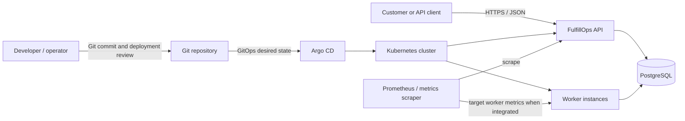
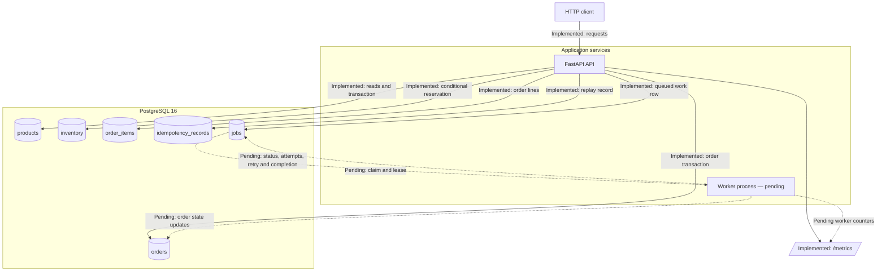
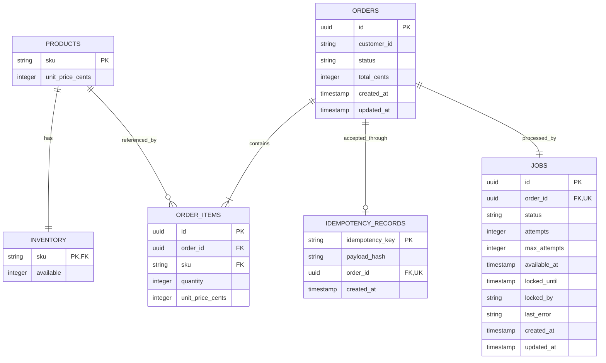
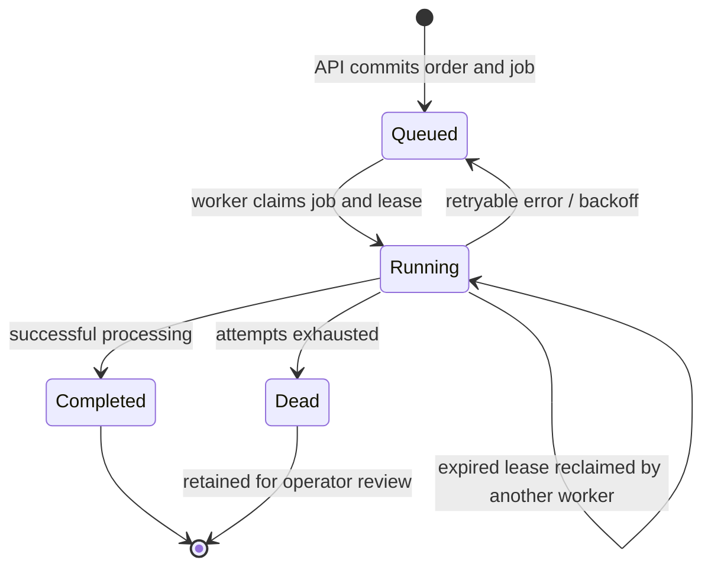
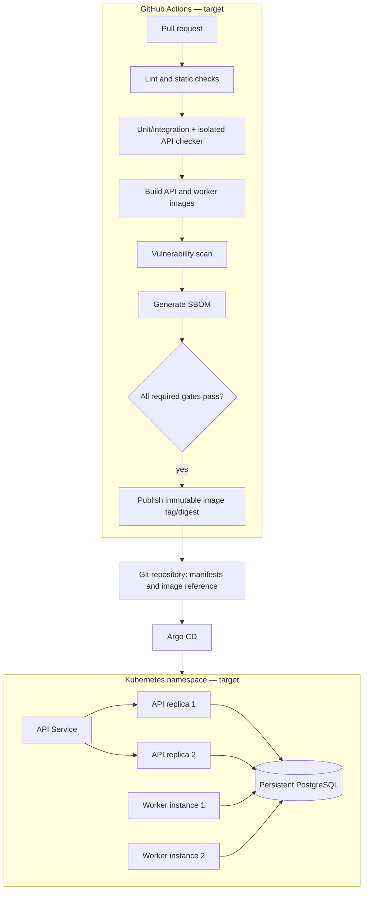

# FulfillOps — System Architecture

**Document status:** Architecture baseline for the complete team project.
**Last updated:** 12 November 2026
**Related decision:** [`ADR-001 — PostgreSQL as the transactional store and durable work table`](ADR-001.md)

> **Implementation boundary:** The FastAPI/PostgreSQL backend, schema, migrations, seed routine, transactional order acceptance, and local backend tests are implemented. The `jobs` table is present and populated atomically with new orders. The separate worker and the delivery/platform components described as target behavior below are not yet integrated in the current backend snapshot. Diagrams distinguish implemented paths from pending paths.

## 1. Purpose and system scope

FulfillOps is a resilient order-processing platform for a fictional electronics fulfilment business. It accepts customer orders over HTTP, reserves stock exactly once at acceptance time, persists the accepted order and its asynchronous work, and allows an independent worker process to complete the order.

The complete project includes five logical concerns:

1. **API:** validates requests, exposes catalog and inventory, accepts orders, returns order status, and exposes health/metrics endpoints.
2. **Transactional persistence:** stores products, inventory, orders, order items, idempotency keys, and durable jobs in PostgreSQL.
3. **Worker:** claims durable jobs, processes accepted orders, records completion/failure, and recovers from crashes through leases and bounded retries.
4. **Delivery platform:** builds and tests the application, scans dependencies/images, generates an SBOM, and deploys versioned images through Docker/Kubernetes and Argo CD.
5. **Operations:** observes health, request latency, order failures and worker retries; performs controlled recovery and records incidents.

The architecture is designed to satisfy the FulfillOps API contract v1.1 and the advanced reliability requirements. No additional public HTTP routes are required for the advanced requirements.

## 2. Quality attributes and design goals

| Attribute | Design goal | Mechanism |
|---|---|---|
| Correctness | Never oversell or partially reserve an order. | Conditional inventory updates and one PostgreSQL transaction across all order rows and stock changes. |
| Idempotency | A retry must not create another order or reservation. | Durable idempotency mapping, canonical payload hash, unique constraints, and transaction-scoped advisory lock. |
| Durability | An accepted order must not disappear if a process restarts. | PostgreSQL persistence and atomic creation of the order plus its job. |
| Concurrency | Multiple API and worker instances can share state safely. | Database coordination rather than process-local locks; worker claims use row locking and leases. |
| Recoverability | Work abandoned by a dead worker can be retried. | Persisted lease expiry, retry scheduling, and dead-letter state. |
| Observability | Operators can distinguish liveness, readiness, load, latency, failures, and retries. | Health endpoints, structured logs, and Prometheus metrics. |
| Reproducibility | A reviewer can reproduce the stack and evidence. | Migrations, seed script, automated tests, immutable images, Compose and Kubernetes manifests. |
| Security | Secrets and internal failures are not exposed. | Environment/Secret configuration, validation, bounded requests, safe errors/logging, least privilege. |

## 3. System context and high-level design

### 3.1 Context diagram



### 3.2 Runtime component diagram

Solid arrows identify implemented backend interactions. Dotted arrows identify the worker/platform integration design still to be completed.



### 3.3 Responsibilities and boundaries

| Component | Responsibility | State ownership |
|---|---|---|
| FastAPI API | Contract validation, catalog/inventory reads, order acceptance, order lookup, health and API metrics. | No authoritative process-local inventory or idempotency state. |
| Order service | Normalization, idempotency, price calculation, stock reservation, and atomic persistence. | Executes transaction in PostgreSQL. |
| PostgreSQL | Shared source of truth for catalog, stock, orders, idempotency, and durable work. | Authoritative persistent state. |
| Worker (pending) | Claim and process work; update order/job state; retry and recover. | Uses PostgreSQL jobs/orders; no in-memory-only authoritative queue. |
| Prometheus (target) | Scrapes and evaluates operational metrics. | Time-series monitoring state external to business transactions. |
| GitHub Actions (target) | Validate code, build images, scan, generate SBOM, and gate releases. | CI artifacts and workflow results. |
| Kubernetes + Argo CD (target) | Run replicas and reconcile deployed state to Git. | Cluster runtime; Git is the desired-state source. |

## 4. Technology and key decisions

| Concern | Selected technology | Rationale |
|---|---|---|
| API framework | FastAPI | Typed endpoints, Pydantic validation and OpenAPI documentation. |
| Runtime | Python 3.12 | Current backend implementation runtime. |
| Validation | Pydantic | Structured request validation and controlled error responses. |
| ORM | SQLAlchemy 2 | Explicit transactions and database models. |
| Database | PostgreSQL 16 | ACID transactions, constraints, conditional updates, advisory locks and row-level locking. |
| Migrations | Alembic | Versioned and reproducible schema evolution. |
| Durable queue/work table | PostgreSQL `jobs` table | Order and work item can be committed atomically in one transaction; no separate broker is required by this design. |
| Tests | pytest / pytest-cov | API, database and concurrency verification. |
| Lint | Ruff | Repeatable static checks. |
| Metrics | Prometheus client library | Counters and request-duration histogram exposed in Prometheus format. |
| Packaging and runtime (target) | Docker / Compose | Reproducible local runtime and service orchestration. |
| Cluster (target) | Kubernetes, kind, Argo CD | Replicated application and GitOps reconciliation. |

The team decision to use PostgreSQL for the durable work table is recorded in [ADR-001](ADR-001.md). The decision avoids a second broker and lets the API atomically save stock reservation, order state, idempotency state, and work. Its trade-off is that database capacity and availability affect both synchronous API acceptance and background processing.

## 5. Order acceptance and API request lifecycle

### 5.1 Sequence diagram

```mermaid
sequenceDiagram
    autonumber
    actor Client
    participant API as FastAPI API
    participant Svc as Order service
    participant DB as PostgreSQL
    participant W as Worker (pending)

    Client->>API: POST /api/v1/orders + Idempotency-Key
    API->>API: Check body size, JSON and request schema
    API->>Svc: Validated order request
    Svc->>Svc: Aggregate duplicate SKU lines; canonicalize payload
    Svc->>DB: BEGIN transaction
    Svc->>DB: Acquire transaction-scoped advisory lock for key
    Svc->>DB: Look up idempotency record
    alt Existing key, same payload
      DB-->>Svc: Existing order mapping
      Svc->>DB: COMMIT / release transaction lock
      Svc-->>API: Original order ID; no stock update
    else Existing key, different payload
      DB-->>Svc: Existing payload hash differs
      Svc-->>API: Idempotency conflict; transaction rolled back
    else New key
      Svc->>DB: Validate SKU and read unit prices
      loop Each normalized SKU in deterministic order
        Svc->>DB: UPDATE inventory SET available = available - qty WHERE available >= qty RETURNING available
        DB-->>Svc: Updated row or no row
      end
      Svc->>DB: Insert order + items + idempotency record + queued job
      Svc->>DB: COMMIT
      DB-->>Svc: Commit successful
      Svc-->>API: New order ID
    end
    API-->>Client: HTTP 202 {order_id, status: queued}
    Note over W,DB: Worker claim/process/retry flow is target integration, not yet implemented
    W-->>DB: Claim job, set lease and order processing (pending)
    W-->>DB: Complete or schedule retry/dead-letter (pending)
```

### 5.2 Validation rules

- The `Idempotency-Key` header is required and must contain 8–128 printable ASCII characters.
- Request body size is limited to 16 KiB.
- `customer_id` is a nonempty string with a maximum length of 64 characters.
- `items` contains 1–10 item objects.
- A SKU must exist in the fixed catalog.
- `quantity` must be an integer from 1 to 20; booleans are rejected even though Python's `bool` is a subclass of `int`.
- Repeated SKU lines are aggregated before payload hashing, stock reservation, and total calculation.
- Prices are stored and calculated as integer cents to avoid floating-point rounding.

### 5.3 Idempotency algorithm

1. Normalize the request by aggregating repeated SKUs and ordering SKU entries deterministically.
2. Serialize the normalized request canonically and calculate its SHA-256 payload hash.
3. Begin a database transaction and acquire a transaction-scoped PostgreSQL advisory lock derived from the idempotency key.
4. Read `idempotency_records` for the key.
5. If the key exists with the same hash, return the mapped order ID without changing inventory.
6. If the key exists with a different hash, return `409 IDEMPOTENCY_CONFLICT`.
7. If the key is new, perform stock reservation and insert the idempotency record in the same transaction as the order and job.

The durable record and database lock coordinate application instances because they are database-level mechanisms, not process-local mutexes. The current local concurrency tests cover simultaneous requests in the tested environment. The required final proof must still run the same-key test against at least two independently running API instances.

### 5.4 Atomic stock reservation

For each normalized SKU, the service executes a conditional update equivalent to:

```sql
UPDATE inventory
SET available = available - :quantity
WHERE sku = :sku
  AND available >= :quantity
RETURNING available;
```

A zero-row result means the requested amount is unavailable. The service raises an out-of-stock error and rolls back the transaction. Because every stock decrement, order row, order item, idempotency mapping, and durable job belongs to the same transaction, a failure on one SKU cannot leave the earlier SKU deductions committed.

SKU updates are issued in a deterministic sorted order to reduce deadlock risk between multi-SKU orders. Database constraints also enforce nonnegative stock.

### 5.5 API contract summary

Base URL in local development: `http://127.0.0.1:8080`.

| Method | Endpoint | Expected behavior |
|---|---|---|
| `GET` | `/health/live` | `200 {"status":"ok"}`; does not depend on database availability. |
| `GET` | `/health/ready` | `200 {"status":"ready"}` only when the database is reachable and required migrations have been applied; otherwise `503 {"status":"not_ready"}`. |
| `GET` | `/api/v1/catalog` | Returns all three required SKUs and integer-cent prices. |
| `GET` | `/api/v1/inventory/{sku}` | Returns nonnegative available quantity; unknown SKU gives `404 SKU_NOT_FOUND`. |
| `POST` | `/api/v1/orders` | Returns `202` only after durable order acceptance and reservation have committed. |
| `GET` | `/api/v1/orders/{order_id}` | Returns ID, status and `total_cents`; unknown ID gives `404 ORDER_NOT_FOUND`. |
| `GET` | `/metrics` | Prometheus text exposition format. |

Required create-order error codes:

| HTTP | Code | Condition |
|---:|---|---|
| 400 | `IDEMPOTENCY_REQUIRED` | Missing idempotency header. |
| 400 | `INVALID_JSON` | Invalid JSON body. |
| 400 | `INVALID_REQUEST` | Invalid request structure. |
| 422 | `INVALID_QUANTITY` | Invalid quantity, including bool/noninteger/out-of-range. |
| 422 | `INVALID_SKU` | SKU not in catalog. |
| 409 | `OUT_OF_STOCK` | Insufficient available stock. |
| 409 | `IDEMPOTENCY_CONFLICT` | Existing key reused for different normalized request. |

Every error has an `error` object with a machine-readable `code` and safe nonempty `message`. Do not expose stack traces, SQL, database connection strings, secrets, or personal data.

The idempotency contract returns HTTP `202` with the original order ID and `status: "queued"` for a same-key/same-payload replay even if the order has since completed. This is an acceptance receipt, not a statement that the current persisted order status is still queued. The current GET order endpoint reports the persisted status.

## 6. Data architecture and schema

### 6.1 Entity relationship diagram



### 6.2 Table responsibilities and constraints

| Table | Important columns | Responsibility and important constraints |
|---|---|---|
| `products` | `sku` primary key, `unit_price_cents` | Fixed catalog; price stored as nonnegative integer cents. |
| `inventory` | `sku` primary key/foreign key, `available` | Available stock per product; check constraint ensures `available >= 0`. |
| `orders` | `id` UUID primary key, `customer_id`, `status`, `total_cents`, timestamps | Durable order and its current lifecycle state. Allowed statuses: `queued`, `processing`, `completed`, `failed`. |
| `order_items` | `id`, `order_id`, `sku`, `quantity`, `unit_price_cents` | Item snapshot and price at order acceptance; positive quantity; SKU lines are aggregated by the service. |
| `idempotency_records` | `idempotency_key` primary key, `payload_hash`, `order_id` unique foreign key, `created_at` | Durable mapping from one client key to one accepted order and semantic request hash. |
| `jobs` | `id`, `order_id` unique foreign key, `status`, attempts, schedule and lease fields, error and timestamps | Durable unit of asynchronous work; one job per order. |

Relationships:

- `inventory.sku` references `products.sku`.
- `order_items.order_id` references `orders.id`.
- `order_items.sku` references `products.sku`.
- `idempotency_records.order_id` references `orders.id` and is unique.
- `jobs.order_id` references `orders.id` and is unique.

Migrations are stored in `db/migrations/versions/`. The current Alembic head is `7a894950e14c` (`add durable worker jobs`).

### 6.3 Seed data

| SKU | `unit_price_cents` | Initial `available` |
|---|---:|---:|
| `KIT-100` | 1299 | 7 |
| `PART-200` | 599 | 12 |
| `PACK-300` | 249 | 5 |

The seed routine inserts missing products and inventory but does not overwrite an existing inventory count. This avoids replenishing consumed stock on every service restart. A separate safe test-only reset procedure is required for repeatable destructive contract tests.

## 7. Durable work processing and recovery

### 7.1 Job and order state models

The implemented `jobs` row contains the fields needed for a lease-based worker contract:

| Field | Meaning |
|---|---|
| `id` | UUID job identifier. |
| `order_id` | Unique order associated with the job. |
| `status` | `queued`, `running`, `completed`, or `dead`. |
| `attempts` | Number of processing attempts recorded. |
| `max_attempts` | Maximum permitted attempts; model default is 5. |
| `available_at` | Earliest time the job may be claimed. |
| `locked_until` | Lease expiry time for the worker currently holding the job. |
| `locked_by` | Worker instance identifier holding the lease. |
| `last_error` | Safe summary of the most recent failure. |
| `created_at`, `updated_at` | Audit timestamps. |

Order states: `queued → processing → completed` on success, or `queued/processing → failed` after retry exhaustion. Job states: `queued → running → completed`, with retryable failures returning to `queued`; exhausted jobs become `dead`.



The state machine is a target contract for worker integration. It is not evidence that the worker state transitions are implemented yet.

### 7.2 Worker claim protocol (target)

1. Start a short PostgreSQL transaction.
2. Select one or more due jobs where either:
   - `status = 'queued'` and `available_at <= now()`, or
   - `status = 'running'` and `locked_until < now()` (abandoned lease).
3. Use `FOR UPDATE SKIP LOCKED` so concurrent workers claim different rows without waiting on the same job.
4. Update the selected job to `running`, increment attempts according to the agreed attempt-counting convention, set `locked_by` and `locked_until`, and update timestamps.
5. Transition the order to `processing` if it is not already terminal.
6. Commit the claim transaction before doing potentially slow processing.
7. Perform the business processing outside the claim transaction/row lock. Extend the lease when processing duration requires it.
8. In a new short transaction, persist success or retry/dead-letter outcome.

The exact definition of when `attempts` increments (on claim versus on failed attempt) must be consistent in code, tests, logs and the operator documentation. The model currently provides the counter and maximum but does not itself implement this policy.

### 7.3 Retry, poison-job and dead-letter behavior (target)

For retryable failure:

- Store a safe `last_error` summary, never a traceback containing secrets or connection strings.
- Release the current lease (`locked_by` and `locked_until` cleared or reset according to implementation).
- If attempts remain, set `status = 'queued'` and set `available_at` using bounded exponential backoff, optionally with jitter.
- Increment `fulfillops_worker_retries_total` when a retry is scheduled.

For exhausted attempts:

- Set job `status = 'dead'`.
- Set order `status = 'failed'`.
- Retain the job, order, and order items for audit and operator review.
- Do not automatically restock the order or delete the work record.
- Define a manual reconciliation/repair procedure rather than silently treating a poison order as successful.

For success:

- In one transaction, set job `status = 'completed'` and order `status = 'completed'`.
- Ensure the business outcome cannot be applied twice if the worker crashes after performing an action but before acknowledging completion.

### 7.4 At-least-once delivery and exactly-once business effect

The worker queue is designed for **at-least-once delivery**, because an expired lease can cause a job to be attempted again. Exactly-once execution of arbitrary code cannot be guaranteed merely by locking a database row. The system must instead make the business effect idempotent:

- Record a durable completion/effect marker in the same transaction as the business state change where possible.
- Use the job/order ID as an idempotency key for any external downstream operation that supports idempotency.
- If an external side effect cannot participate in the database transaction, use a separately designed outbox/inbox or reconciliation mechanism; do not claim atomic exactly-once effects across unrelated systems without proof.
- A repeated worker attempt must detect a previously committed effect and finish/acknowledge the job without applying the effect again.

The API reserves inventory once. A worker retry must never decrement inventory again. A failed/poisoned order keeps reserved stock until an explicitly designed compensating workflow is approved and tested.

## 8. Observability and service health

### 8.1 Health checks

- `GET /health/live`: process liveness only; returns `200 {"status":"ok"}` while the API process is alive, even if PostgreSQL is unavailable.
- `GET /health/ready`: checks the database and migration readiness; returns `200 {"status":"ready"}` when it can safely accept orders, otherwise `503 {"status":"not_ready"}`.

**Hardening item:** the current readiness implementation checks database access and that an Alembic version row exists. Before final acceptance, verify that the applied revision matches the required application migration head (or an explicitly compatible revision policy), rather than treating any nonempty version table as sufficient.

### 8.2 Metrics

The backend exposes `/metrics` in Prometheus text format. Current metric families include:

| Metric | Purpose | Current implementation status |
|---|---|---|
| `fulfillops_orders_created_total` | Count accepted orders. | Declared and incremented after successful order creation. |
| `fulfillops_orders_failed_total` | Count orders that ultimately fail. | Declared; worker/failure-path instrumentation is still required. |
| `fulfillops_worker_retries_total` | Count scheduled worker retries. | Declared; worker instrumentation is still required. |
| `fulfillops_http_requests_total` | Count HTTP requests by method, route template and status. | Implemented in API middleware. |
| HTTP request-duration histogram | Observe request latency and support p95 calculation. | Implemented in API middleware; collect at least 200 samples for final evidence. |

Metric labels must not contain customer identifiers, order identifiers, raw URLs with identifiers, or idempotency keys. The Prometheus scraper/dashboard and worker metric endpoint integration are platform work still to be completed.

### 8.3 SLO and latency evidence

A suggested local evaluation target in the project brief is 99.5% successful requests over the evaluation window and p95 request latency below 300 ms. These are proposed targets, not measured results. Final reporting must:

- collect at least 200 request samples in a reproducible isolated local test;
- record the sample count, path mix, concurrency, machine/cluster resources, warm-up, and time window;
- calculate observed p95 from the sample distribution or histogram;
- distinguish local-lab observations from production SLOs; and
- state that a single local kind/Docker environment is not representative of multi-zone production behavior.

## 9. Deployment architecture and delivery pipeline

### 9.1 Target runtime topology



This is the required target, not the current deployment. The project may run PostgreSQL in-cluster with a persistent volume or use another documented persistent database configuration suitable for the lab. A database restart must not erase accepted orders or idempotency state.

### 9.2 Container requirements

- Build API and worker as multistage images, or one reusable image with distinct commands.
- Run application processes as a non-root user.
- Keep build tools out of runtime layers where possible.
- Pin/review base images and dependencies; include a `.dockerignore`.
- Configure explicit health checks and resource limits.
- Keep secrets outside image layers and Git.
- Provide Compose services for API, worker, and persistent PostgreSQL, with named volumes and health dependencies.

The current `compose.yaml` is used for the PostgreSQL development service. Full API/worker images and Compose orchestration are pending.

### 9.3 CI pipeline and supply-chain requirements

The required pull-request workflow should run, in order or in a controlled dependency graph:

1. Formatting/lint and static analysis.
2. Unit and integration tests against an isolated database.
3. Contract checker including concurrency and stress modes against a freshly seeded test dataset.
4. API and worker image build.
5. Dependency and container image vulnerability scan with a written blocking policy.
6. SBOM generation and retention as a machine-readable CI artifact.
7. Publish immutable images identified by commit SHA/digest only after all required gates pass.

Use pinned GitHub Actions versions or reviewed release tags, least-privilege workflow permissions, and GitHub Secrets for credentials. Demonstrate at least one red pipeline followed by a corrected green pipeline. A critical failing check must block promotion.

### 9.4 Kubernetes and GitOps requirements

- API Deployment: two replicas behind a Service.
- Worker Deployment: two independently operating worker instances.
- Readiness and liveness probes with appropriate semantics.
- CPU/memory requests and limits.
- ConfigMap for non-secret configuration and Secret references for credentials.
- Persistent database storage/configuration.
- Namespace-scoped manifests or Kustomize overlays.
- Argo CD Application reconciled from the Git repository.
- Demonstrate drift detection and restoration to Git-defined desired state.

For a faulty rollout, readiness/progression must stop the unhealthy revision. Recovery must end in a known-good Git revision reconciled by Argo CD, not only a manual `kubectl patch`. For a healthy rolling release, collect a continuous, timestamped 30-second readiness probe and retain the CSV/evidence.

## 10. Security and threat model

The following threat model covers realistic risks for this project. Mitigations must be implemented and verified where indicated; a documented mitigation is not proof that it is already active.

| Threat | Potential impact | Mitigation / verification |
|---|---|---|
| T1 — Database credentials or GitHub tokens committed to Git or printed in logs | Unauthorized access to the database or repository. | `.env` ignored; placeholders only in `.env.example`; use GitHub Secrets/Kubernetes Secret references; secret scanning; redact logs; rotate any exposed credential. |
| T2 — Malformed/oversized request or invalid input | Resource exhaustion, unexpected type coercion, or invalid business state. | 16 KiB body limit, Pydantic/schema validation, strict integer quantity checks, bounded item count, and safe error responses. Add negative/boundary tests. |
| T3 — Concurrent order requests oversell inventory | Negative stock, incorrect financial/order state. | Conditional SQL update with `available >= quantity`, check constraint, transaction rollback, deterministic SKU order, and distinct-key race tests. Final proof must include multiple API replicas. |
| T4 — Idempotency-key replay or key reuse with altered payload | Duplicate order/reservation or a client hiding a different request behind a prior key. | Canonical payload hash, durable mapping, transaction-scoped advisory lock, unique key, same-payload replay test, and conflict test. |
| T5 — Worker dies after claiming a job or while executing an effect | Accepted work can remain stuck or be performed twice. | Lease expiry/reclaim, atomic claim via `SKIP LOCKED`, bounded retries, idempotent business effect, and worker-kill recovery test. Worker implementation and proof pending. |
| T6 — Poison job retries forever or is silently dropped | Resource exhaustion and loss of operational visibility. | `max_attempts`, persisted retry schedule, `dead` job and `failed` order, retained audit state, and deterministic poison-job test. Worker implementation pending. |
| T7 — Vulnerable dependency or compromised build artifact | Runtime compromise or supply-chain exposure. | CI vulnerability scan, documented severity/blocking policy, SBOM artifact, immutable image digest, reviewed/pinned build actions. CI work pending. |
| T8 — Faulty deployment or configuration drift | API outage, failed readiness, or inconsistent runtime state. | Readiness-gated rollout, two replicas, GitOps reconciliation, known-good Git rollback, 30-second rollout probe, and broken-release exercise. Platform work pending. |
| T9 — Sensitive data leaks through metrics, errors, or logs | Exposure of customer or internal operational data. | Safe machine-readable errors, avoid customer/order/key metric labels, structured log redaction, and review of log/metric content. |
| T10 — Destructive test/checker run against shared or production database | Unrecoverable stock/data loss. | Test database name guard, isolated disposable data, documented reset safety checks, and no destructive checker use on shared services. |

### Security assumptions and residual risks

- The local `/metrics` endpoint is acceptable only inside the isolated lab network; a production deployment should restrict access to trusted monitoring infrastructure.
- The design currently treats PostgreSQL as the trusted coordination boundary. Database credentials therefore require strong handling and least-privilege roles.
- A worker using at-least-once delivery cannot safely repeat a non-idempotent external action without downstream idempotency or a reconciliation design.
- The project is a local educational environment, not a production security certification. The report must state its limitations.

## 11. Reliability invariants and acceptance criteria

The following invariants apply across the API, worker and deployment:

1. `inventory.available >= 0` at all times.
2. A multi-SKU order reserves all required stock or none.
3. A given idempotency key maps to at most one accepted order.
4. A same-key/same-payload replay returns the original order ID and does not decrement stock again.
5. A same-key/different-payload request is rejected as `IDEMPOTENCY_CONFLICT`.
6. The order, order lines, stock changes, idempotency mapping, and durable job are committed atomically.
7. API acceptance is separate from worker completion; HTTP `202` is returned after persistence and before worker processing.
8. Accepted orders and idempotency records survive API and worker process restarts.
9. Two workers cannot apply the same live job concurrently; expired leases can be reclaimed.
10. Retry exhaustion results in a persistent dead job and failed order, not silent deletion or infinite retry.
11. Worker processing never reserves stock a second time.
12. An unhealthy release is not promoted; GitOps recovery restores a known-good Git state.
13. CI creates an SBOM and enforces the documented quality/security gate before image promotion.

### Mandatory final proof matrix

| Requirement | Required demonstration | Current status |
|---|---|---|
| Backend contract | All mandatory API routes/error codes and seeded catalog. | Backend routes/manual checks and automated tests reported passing; full public checker not yet reported. |
| Distinct-key inventory race | More simultaneous orders than available stock; accepted count never exceeds stock. | Local automated concurrency test reported passing. |
| Same-key idempotency race | Eight simultaneous same-key requests across two API instances; one order ID and one reservation. | Eight concurrent requests tested locally; cross-replica test still pending. |
| Worker crash recovery | Two workers; kill one after claim; lease reclaimed and order completes without duplicate business effect. | Pending worker implementation. |
| Poison job | Attempt count is bounded; job becomes `dead`, order `failed`, record retained. | Pending worker implementation. |
| CI quality/security and SBOM | Red-to-green PR, scanner output, SBOM artifact, immutable image identity. | Pending. |
| Kubernetes/GitOps | Two API and two worker instances, healthy Argo CD sync, drift recovery. | Pending. |
| Rolling update | Timestamped successful 30-second readiness probe and unhealthy revision recovery. | Pending. |
| Observed p95 | At least 200 local samples, conditions and limitations documented. | Pending. |
| Incident response | Two controlled fault exercises and blameless postmortem. | Pending. |

## 12. Open implementation and integration checklist

### Backend hardening

- [ ] Strengthen readiness to verify the expected/compatible Alembic revision, not merely the existence of a version row.
- [ ] Confirm API status behavior and response schemas against the supplied public checker after worker integration.
- [ ] Keep `ORDERS_FAILED` and `WORKER_RETRIES` metrics tied to real terminal-failure/retry events.

### Worker integration

- [ ] Implement atomic `SKIP LOCKED` job claims and persisted leases.
- [ ] Implement expired-lease recovery and two-worker operation.
- [ ] Implement bounded exponential retry/backoff and deterministic poison-job handling.
- [ ] Implement idempotent completion/effect markers and order/job state transitions.
- [ ] Prove no duplicate reservation and no duplicate business effect after worker crash/restart.

### Platform and operations

- [ ] Build non-root multistage API and worker images.
- [ ] Complete Compose stack with persistent data and health checks.
- [ ] Add PR CI, public checker, scan policy, SBOM, immutable artifacts and promotion gates.
- [ ] Add Kubernetes and Argo CD manifests; deploy two API and two worker instances.
- [ ] Verify secrets are never committed and resources have probes/requests/limits.
- [ ] Demonstrate drift detection and Git-based restoration after a broken release.
- [ ] Perform both failure exercises, collect 30-second rollout evidence, and measure p95 from at least 200 samples.
- [ ] Write the final incident postmortem and preserve all reproducible evidence.

## 13. References

- `FulfillOps_Assignment_EN.md` — capstone problem, work packages, grading and advanced reliability requirements.
- `API_CONTRACT_EN.md` — authoritative public HTTP routes, validation, status codes, payloads and advanced API guarantees.
- `SETUP_AND_SUBMISSION_EN.md` — setup, checker safety, deployment, and submission guidance.
- [`ADR-001.md`](ADR-001.md) — decision to use PostgreSQL as the transactional store and durable work table.

