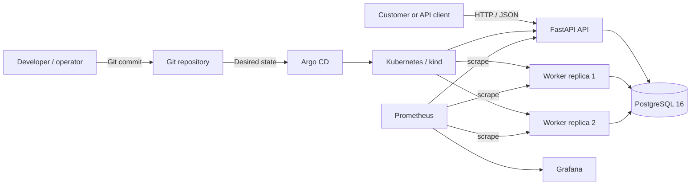
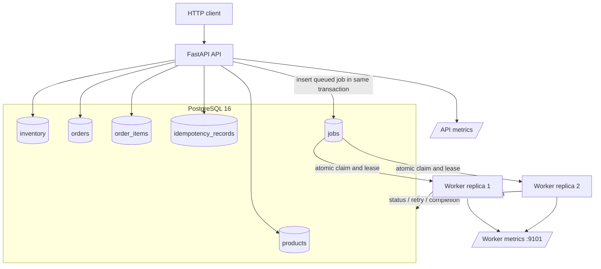
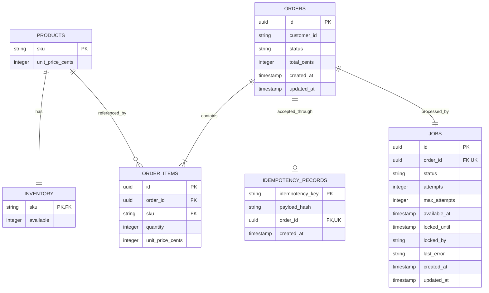

# FulfillOps — System Architecture

**Document status:** Integrated project architecture and evidence snapshot  
**Last reviewed:** 14 November 2026  
**Related decision:** [`ADR-001.md`](ADR-001.md) — PostgreSQL as the transactional store and durable work table

> **Implementation boundary:** The API, PostgreSQL persistence, durable worker, Docker Compose stack, Kubernetes/kind deployment, Argo CD Application and monitoring components are present and have been exercised. This document distinguishes demonstrated behavior from known gaps: actual in-flight worker process-kill recovery, a complete GitOps drift proof, a blocking CI vulnerability policy, non-root multi-stage images and API/worker resource requests/limits remain outstanding or incomplete.

## 1. Purpose and system scope

FulfillOps is a resilient order-processing platform for a fictional electronics-fulfilment business. It accepts orders over HTTP, reserves inventory once at acceptance, persists the accepted order and its work item, and processes the work asynchronously in independent worker processes.

The system has five logical concerns:

1. **API:** validates requests, exposes catalog and inventory, accepts orders, returns order status, and exposes health and Prometheus metrics.
2. **Transactional persistence:** stores products, inventory, orders, order items, idempotency records and durable jobs in PostgreSQL.
3. **Worker:** claims durable jobs, transitions orders, completes work, schedules bounded retries and retains permanently failing jobs for operator review.
4. **Delivery platform:** builds and tests the application, scans its image, produces an SBOM and deploys the services through Docker/Kubernetes and Argo CD.
5. **Operations:** observes readiness, request latency, order failures and worker retries; performs controlled recovery and records incidents.

The public HTTP contract is version 1.1. Advanced reliability behavior is implemented behind the existing routes; it does not require additional public API endpoints.

## 2. Quality attributes and invariants

| Attribute | Required property | Mechanism / evidence |
|---|---|---|
| Correctness | No overselling and no partial multi-SKU reservation. | Conditional inventory updates inside one transaction; public checker concurrency test passed. |
| Idempotency | Replays cannot create a second order or reserve stock again. | Canonical payload hash, durable idempotency record and transaction-scoped advisory lock; replay/conflict and eight-request same-key checks passed. |
| Durability | Committed orders survive process/container restarts. | PostgreSQL persistent volume; an order remained completed after database, API and worker restarts. |
| Concurrency | Multiple API and worker processes coordinate through shared state. | Database-level locks/constraints and atomic job claims; concurrent inventory and worker-replica scenarios exercised. |
| Recoverability | Abandoned jobs can be retried and permanently failing jobs retained. | Persisted leases, retry scheduling and dead-letter state; lease-expiry and poison-job scenarios exercised. A real in-flight process kill is not yet conclusively demonstrated. |
| Observability | Operators can see health, requests, latency, order failures and worker retries. | Health endpoints, structured logs and Prometheus metrics; 200 HTTP samples and rollout observations recorded. |
| Reproducibility | Reviewer can recreate the stack and test environment. | Compose files, migrations, seed routine, tests, Kubernetes manifests and evidence documents. |
| Security | Secrets and internal failures are not exposed. | Environment variables, Kubernetes Secret references, validation and safe errors; container and CI hardening gaps remain. |

Core invariants:

- `inventory.available` never becomes negative.
- A failed multi-SKU order rolls back all stock changes.
- One idempotency key maps to at most one accepted order.
- A same-key/same-payload replay returns the original order without another reservation.
- A same-key/different-payload replay is rejected.
- The order, lines, inventory changes, idempotency record and durable job are committed together.
- The worker never reserves inventory a second time.
- Retries and lease recovery must not produce a duplicate business outcome.

## 3. System context and components

### 3.1 Context diagram



### 3.2 Component responsibilities

| Component | Responsibility | State ownership |
|---|---|---|
| FastAPI API | Contract validation, catalog/inventory reads, order acceptance, order lookup, health and API metrics. | No authoritative process-local inventory or idempotency state. |
| Order service | Normalization, idempotency, price calculation, stock reservation and atomic persistence. | Performs the business transaction in PostgreSQL. |
| PostgreSQL | Shared source of truth for catalog, stock, orders, idempotency and durable work. | Authoritative persistent state. |
| Worker process | Claims work, marks orders processing/completed/failed, retries and recovers expired leases. | Uses the shared `jobs` and `orders` tables. |
| Prometheus | Scrapes API and worker metrics. | Monitoring time series, separate from business transactions. |
| Grafana | Displays metrics from Prometheus. | Dashboards and visualisation. |
| GitHub Actions | Runs automated tests, builds the image, scans it and creates an SBOM artifact. | CI logs and artifacts. Vulnerability findings are currently report-only. |
| Kubernetes + Argo CD | Runs replicated services and reconciles the cluster from Git. | Git is the desired-state source; Kubernetes is runtime state. |

### 3.3 Runtime component diagram



## 4. Technology and key decisions

| Concern | Technology | Reason |
|---|---|---|
| API framework | FastAPI | Typed routes, Pydantic validation and OpenAPI. |
| Runtime | Python 3.12 | Shared API and worker runtime. |
| ORM | SQLAlchemy 2 | Explicit database transactions and model mapping. |
| Database | PostgreSQL 16 | ACID transactions, constraints, conditional updates, advisory locks and row locking. |
| Durable work table | PostgreSQL `jobs` table | Order, inventory, idempotency and work can be committed atomically; no separate broker is required. |
| Migrations | Alembic | Versioned schema evolution. |
| Tests / lint | pytest, pytest-cov, Ruff | Regression, integration and concurrency validation. |
| Runtime packaging | Docker / Compose | Reproducible services and isolated test stack. |
| Cluster | Kubernetes / kind | API and worker replicas, persistent database and probes. |
| GitOps | Argo CD | Reconcile cluster manifests from the Git repository. |
| Observability | Prometheus and Grafana | Scrape application metrics and visualise runtime behavior. |
| CI / security | GitHub Actions, Trivy, CycloneDX | Automated test/build, image scan and SBOM artifact. |

The PostgreSQL decision and alternatives are documented in [`ADR-001.md`](ADR-001.md). PostgreSQL is both the authoritative business-data store and the durable work table. This simplifies atomic acceptance but makes database availability and capacity important to both synchronous API acceptance and asynchronous processing.

## 5. Order acceptance and API request lifecycle

### 5.1 Sequence diagram

```mermaid
sequenceDiagram
    autonumber
    actor Client
    participant API as FastAPI API
    participant Svc as Order service
    participant DB as PostgreSQL
    participant W as Worker

    Client->>API: POST /api/v1/orders + Idempotency-Key
    API->>API: Validate body, JSON and request schema
    API->>Svc: Validated order request
    Svc->>Svc: Aggregate duplicate SKUs and canonicalise payload
    Svc->>DB: BEGIN transaction
    Svc->>DB: Acquire transaction-scoped advisory lock
    Svc->>DB: Read idempotency record
    alt Existing key and same payload
      DB-->>Svc: Original order mapping
      Svc-->>API: Original order ID; no stock update
    else Existing key and different payload
      Svc-->>API: 409 IDEMPOTENCY_CONFLICT
    else New key
      Svc->>DB: Validate SKU and read unit prices
      loop Each normalised SKU
        Svc->>DB: Conditional stock decrement (available >= requested)
        DB-->>Svc: Updated row or no row
      end
      Svc->>DB: Insert order, items, idempotency row and queued job
      Svc->>DB: COMMIT
      Svc-->>API: New order ID
    end
    API-->>Client: HTTP 202 acceptance receipt
    W->>DB: Claim due job and persist lease
    W->>DB: Update order processing state
    W->>DB: Complete or schedule bounded retry / dead-letter
```

### 5.2 Transaction boundary

For a new order, the service:

1. Validates the request and aggregates repeated SKU lines.
2. Orders the normalized SKU entries deterministically and calculates a canonical payload hash.
3. Begins a PostgreSQL transaction and obtains a transaction-scoped advisory lock for the idempotency key.
4. Checks the durable idempotency record.
5. Validates product existence and unit prices.
6. Reserves stock through conditional updates equivalent to:

   ```sql
   UPDATE inventory
   SET available = available - :quantity
   WHERE sku = :sku AND available >= :quantity
   RETURNING available;
   ```

7. Inserts the order, order items, idempotency mapping and one queued `jobs` row.
8. Commits before returning HTTP `202 Accepted`.

If any SKU cannot be reserved, the transaction rolls back all earlier stock updates and order writes. The worker does not decrement inventory again.

### 5.3 Idempotency algorithm

1. Normalize the request by aggregating duplicate SKUs and sorting entries consistently.
2. Serialize the normalized request and compute a SHA-256 payload hash.
3. Acquire a transaction-scoped PostgreSQL advisory lock derived from the key.
4. Look up the key in `idempotency_records`.
5. If the key exists with the same hash, return its original order ID without changing inventory.
6. If the key exists with a different hash, reject the request with `409 IDEMPOTENCY_CONFLICT`.
7. Otherwise perform stock reservation and insert the idempotency record with the order and job in the same transaction.

The database-level lock coordinates API processes; it is not a process-local mutex. The public checker passed its eight-concurrent-identical-key test. A dedicated cross-replica same-key proof should still be retained as separate evidence if required by the instructor's hard gate.

## 6. API contract and validation

| Method | Endpoint | Behavior |
|---|---|---|
| `GET` | `/health/live` | Liveness response, independent of database readiness. |
| `GET` | `/health/ready` | Ready response when the database and application are ready; otherwise not-ready. |
| `GET` | `/api/v1/catalog` | Returns the required product SKUs and integer-cent prices. |
| `GET` | `/api/v1/inventory/{sku}` | Returns nonnegative available stock; unknown SKU returns `404`. |
| `POST` | `/api/v1/orders` | Validates and durably accepts an order; returns `202`. |
| `GET` | `/api/v1/orders/{order_id}` | Returns ID, persisted status and `total_cents`; unknown ID returns `404`. |
| `GET` | `/metrics` | Prometheus text exposition. |

Validation rules:

- `Idempotency-Key` is required and must contain 8–128 printable ASCII characters.
- Request body is limited to 16 KiB.
- `customer_id` is a nonempty string of at most 64 characters.
- `items` contains 1–10 item objects.
- Each SKU must exist in the fixed catalog.
- Quantity is an integer from 1 to 20; booleans are rejected.
- Repeated SKU lines are aggregated before hashing, stock reservation and billing.
- Prices and totals use integer cents.

Important error codes include `IDEMPOTENCY_REQUIRED`, `INVALID_JSON`, `INVALID_REQUEST`, `INVALID_QUANTITY`, `INVALID_SKU`, `OUT_OF_STOCK`, `IDEMPOTENCY_CONFLICT`, `SKU_NOT_FOUND` and `ORDER_NOT_FOUND`. Error responses use a machine-readable code and safe message; they must not expose SQL, stack traces, secrets or database connection strings.

## 7. Data architecture

### 7.1 Entity relationship diagram



### 7.2 Table responsibilities

| Table | Responsibility | Important constraints / fields |
|---|---|---|
| `products` | Fixed catalog. | SKU primary key; unit price stored as nonnegative integer cents. |
| `inventory` | Available stock per product. | SKU primary/foreign key; check prevents negative stock. |
| `orders` | Accepted order and lifecycle status. | UUID key; customer reference, status, total and timestamps. |
| `order_items` | Accepted line and price snapshot. | Order/product foreign keys; positive quantity and unit price in cents. |
| `idempotency_records` | One client key to one semantic request and order. | Key primary key, payload hash and unique order reference. |
| `jobs` | Durable asynchronous work item. | One job per order; status, attempts, availability, lease, worker identity and safe error. |

The fresh seed catalog is `KIT-100` (€12.99, 7 units), `PART-200` (€5.99, 12 units) and `PACK-300` (€2.49, 5 units). Seeding does not replenish already-consumed inventory on every run.

## 8. Worker architecture and job lifecycle

### 8.1 Job state model

The durable job states are:

- `queued`: due or scheduled for a later retry;
- `running`: claimed by one worker with a persisted lease;
- `completed`: successfully processed;
- `dead`: retry budget exhausted and retained for operator review.

Order states include `queued`, `processing`, `completed` and `failed`.

### 8.2 Claim, lease and retry behavior

The worker is a separate process (`python -m worker.main`). It polls PostgreSQL, atomically claims due work using database row locking (the implementation uses a skip-locked claim pattern), records worker identity and lease expiry, and updates the order lifecycle. The configured defaults include a two-second poll interval, five maximum attempts and a 30-second lease in the Compose/Kubernetes configuration.

On success, the worker marks the job and order completed. On a retryable failure, it stores a safe error, increments the attempt count, schedules a bounded retry with backoff and makes the job claimable again when due. After the attempt limit, the job becomes `dead` and the order becomes `failed` for operator review. The worker must not decrement inventory again because stock was reserved in the API transaction.

The queue is at-least-once. Exactly-once delivery is not assumed. The business-side effect must be idempotent so a retry or lease recovery does not create a duplicate outcome.

### 8.3 Worker verification boundary

Observed exercises include two worker replicas operating against the same database, jobs being distributed across workers, bounded retry and poison-job/dead-letter behavior, and expired-lease recovery. **A real worker process termination after claiming an in-flight committed order, followed by automatic lease recovery and proof of one business outcome, remains an outstanding hard-gate demonstration.** Do not describe lease-expiry simulation as equivalent to killing the worker process.

## 9. Docker Compose environments

The development Compose file defines:

- `db`: PostgreSQL 16, persistent `postgres_data` volume and host port `5433`;
- `migrate`: one-shot Alembic migration service;
- `api`: FastAPI service, host port `8000`;
- `worker`: separate worker process with metrics port `9101` exposed internally.

The test override `compose.test.yaml` changes the database name to `fulfillops_test`, publishes PostgreSQL on `5544` and API on `8001`, and uses a distinct named volume `fulfillops_test_postgres_data`. This separation was explicitly verified before running the instructor checker. Never attach the test database container to the development `postgres_data` volume.

The instructor-provided public checker is run against the isolated API. The observed full result on 14 November 2026 was **15 passed / 0 failed / 0 skipped** with `--concurrency --stress` enabled. See [`public-checker-evidence.md`](public-checker-evidence.md).

## 10. Kubernetes and Argo CD deployment

### 10.1 Kubernetes topology

The `k8s/` directory contains the Kustomize application and manifests for PostgreSQL, API, worker, Prometheus, Grafana and seed support. The deployed `fulfillops` namespace was observed with:

- API Deployment: two replicas and a Service;
- Worker Deployment: two replicas, with `WORKER_ID` sourced from Pod metadata;
- PostgreSQL: one instance with a persistent volume claim;
- Database password: referenced from Kubernetes Secret `fulfillops-db-secret`;
- API readiness probe: `/health/ready`;
- API liveness probe: `/health/live`;
- Prometheus scrape configuration for API and worker metrics;
- Grafana connected to Prometheus.

The API Deployment uses a rolling strategy with `maxUnavailable: 0` and `maxSurge: 1`. The current API and worker Deployment manifests still need explicit CPU/memory requests and limits. The current image is also not yet configured as a non-root multi-stage build.

### 10.2 GitOps

The Argo CD Application under `infra/argocd/` points to the repository's `main` branch and the `k8s/` path. Automatic sync and self-healing are enabled; pruning is disabled.

The application was observed in `Synced` and `Healthy` state. A deliberately broken readiness path (`/health/intentional-failure`) generated HTTP 404 readiness-probe failures. The broken change was reverted in Git, after which the known-good readiness paths were restored and Argo CD returned to a healthy state.

A manual replica-scale drift exercise ended with two replicas and `Synced`/`Healthy`, but the intermediate reconciliation evidence is incomplete. Treat the full drift/self-healing hard gate as **partially demonstrated**, not fully proven.

## 11. CI, security and supply-chain evidence

The workflow `.github/workflows/ci.yml` includes a test job backed by PostgreSQL, Python dependency installation, Alembic migration and pytest execution. A security job builds the API image, scans it with Trivy, creates a CycloneDX SBOM and uploads `trivy-report.json` and `sbom.json` as artifacts.

The reviewed Trivy step sets `exit-code: '0'`. This means findings are reported without failing the workflow. Therefore:

- image scanning exists;
- a Trivy report artifact is generated;
- a CycloneDX SBOM artifact is generated;
- an enforced vulnerability-blocking quality gate is **not** yet established.

The current repository `Dockerfile` is a single-stage `python:3.12-slim` build and does not switch to a non-root runtime user. A multi-stage, non-root API/worker image remains a hardening task. Pinning actions, defining an explicit severity threshold and documenting exception handling should be included in the next security review.

## 12. Observability and reliability evidence

### 12.1 Metrics

The API metrics include:

- `fulfillops_orders_created_total`;
- `fulfillops_orders_failed_total`;
- `fulfillops_http_requests_total`;
- `fulfillops_http_request_duration_seconds`.

Worker metrics include retry and process-level metrics, exposed on port `9101`; `fulfillops_worker_retries_total` is one of the recorded counters. Avoid using customer identifiers, idempotency keys or other high-cardinality/sensitive values as metric labels.

### 12.2 HTTP sample result

A 200-request catalog sample was collected from inside the Kubernetes environment:

| Measure | Observed result |
|---|---:|
| Requests | 200 |
| Successful responses | 200 |
| Failed responses | 0 |
| Success rate | 100% |
| p95 latency | approximately 9.236 ms |

The raw measurements are in [`http_samples.csv`](http_samples.csv), with the conditions recorded in [`observability-evidence.md`](observability-evidence.md). This is a measured sample for the tested endpoint and environment, not a universal production SLO guarantee.

### 12.3 Rolling-update probe

A time-stamped probe ran for approximately 30.016 seconds and collected 121 samples while an API ReplicaSet was being replaced. Two requests returned HTTP 502 after upstream timeouts; the service subsequently recovered. This supports a recovery observation, but it does **not** establish uninterrupted zero-error availability during the rollout. The captured CSV is [`rolling_update_probe.csv`](rolling_update_probe.csv).

### 12.4 Controlled release fault

A deliberately broken readiness probe path returned HTTP 404 in Kubernetes events, preventing the new API pod from becoming ready. The Git change was reverted and the healthy manifest restored. The timeline, impact and recovery are recorded in [`incident-postmortem.md`](incident-postmortem.md).

### 12.5 Persistence across restarts

A completed order (`41ce2576-2367-4e42-be76-0dd3efacd108`) remained present with status `completed` after the isolated PostgreSQL container was restarted. The API and worker were then restarted; the readiness endpoint returned `ready` and the API retrieved the same completed order with a total of 996 cents. This demonstrates persistence for the tested order and restart sequence. Full evidence is in [`persistence-evidence.md`](persistence-evidence.md).

## 13. Test strategy and recorded results

| Test / verification | Observed result | Evidence boundary |
|---|---|---|
| Local regression suite | 34 tests passed in the integrated project snapshot. | Re-run after any later code changes; retain the actual test output. |
| Ruff | Passed in the recorded backend validation. | Run `ruff check app tests`. |
| Official public API checker | 15 passed, 0 failed, 0 skipped. | Isolated test Compose deployment; both `--concurrency` and `--stress` enabled. |
| Same-key replay and conflict | Passed. | Public checker. |
| Atomic inventory competition | Passed. | Public checker. |
| Eight identical-key concurrent requests | Passed. | Public checker. |
| Worker completion and stock reduced once | Passed. | Public checker. |
| Two worker replicas and retry/dead-letter scenarios | Exercised. | Separate operational exercises; not equivalent to an actual in-flight process kill. |
| Database/API/worker restart persistence | Passed for recorded order. | Dedicated isolated test volume. |
| Broken-readiness release and Git revert | Recovery demonstrated. | Two probe/Argo CD event evidence. |
| 200 HTTP samples | 200/200 success; p95 ~9.236 ms. | One tested endpoint and environment. |
| 30-second rollout probe | 121 samples, two HTTP 502, subsequent recovery. | Not a zero-error rollout result. |

## 14. Threat model and residual risks

The principal threats include malformed or abusive client requests, inventory overselling, duplicate order acceptance, worker crashes and duplicate effects, loss of database state, credential exposure, vulnerable images, overly privileged containers, metric/log data leakage and broken deployments.

Controls include request validation, transactional stock checks, durable idempotency, database-backed jobs, lease/retry handling, persistent volumes, Secret references, safe errors, health probes, Git-based deployment recovery and monitoring.

Important residual risks remain:

1. Actual in-flight worker process-kill recovery has not been conclusively proven.
2. GitOps drift/self-healing evidence is incomplete.
3. Trivy findings do not currently block CI.
4. Docker build is not yet multi-stage/non-root.
5. API and worker Kubernetes resource requests/limits are missing.
6. Backup/restore, authentication and TLS requirements need environment-specific review.

See [`threat-model.md`](threat-model.md) for the threat register and priorities.

## 15. Team responsibilities and contribution

The agreed team split is:

| Team role | Primary responsibility | Integration boundary |
|---|---|---|
| Student 1 — Backend/database | FastAPI routes, SQLAlchemy models, PostgreSQL schema/migrations, order transaction, inventory reservation, idempotency, seed logic and backend tests. | Publishes and maintains the order/job database contract. |
| Student 2 — Worker/reliability | Separate worker, atomic claims, leases, expired-lease recovery, retries/backoff, dead-letter handling and worker tests. | Consumes the shared PostgreSQL `jobs` table; does not reserve inventory again. |
| Student 3 — Platform/delivery | Container packaging, Compose, GitHub Actions, scanning/SBOM, Kubernetes/kind, Argo CD/GitOps, deployment and rollout evidence. | Packages and deploys API/worker against shared database configuration. |

Individual contribution and AI assistance disclosures are maintained in [`assistance-log.md`](assistance-log.md). Each student must be able to explain their own work and the end-to-end order lifecycle during the individual defence.

## 16. Final acceptance items still outstanding

- [ ] Kill a worker after it claims an in-flight committed order; prove lease recovery and one business outcome.
- [ ] Capture a complete GitOps drift/self-healing sequence with before/after evidence.
- [ ] Configure a documented CI vulnerability threshold that blocks the selected severity and records exceptions.
- [ ] Convert the Dockerfile to a multi-stage build with a non-root runtime user for API and worker.
- [ ] Add CPU and memory requests/limits to API and worker Kubernetes Deployments.
- [ ] Re-run and retain any required cross-replica idempotency proof if the instructor expects it as a separate hard gate.
- [ ] Verify the final report is within the page limit, the demo is within the time limit, instructor repository access works and the submitted ZIP excludes secrets and instructor-provided files.

The project has substantial implemented functionality and test evidence, but these items should remain visible until they are demonstrated and reviewed.
